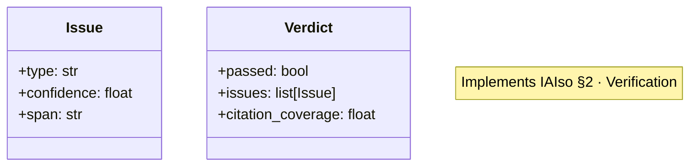
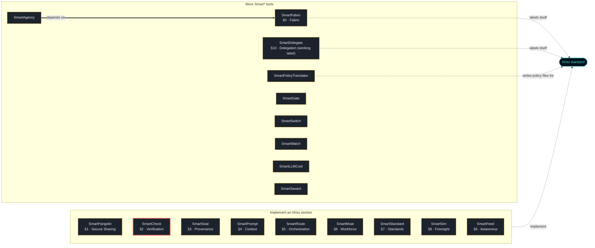

<!-- mcp-name: io.github.smarttasksorg/sf-smartcheck -->
<h1 align="center">🦔 SmartCheck</h1>
<p align="center"><b>Check before you sign off. Catch the AI when it's confidently wrong.</b></p>
<p align="center">
  <a href="https://iaiso.org">IAIso §2 · Verification</a> ·
  <a href="https://smarttasks.cloud">SmartTasks.cloud</a> ·
  <a href="#part-of-the-smart-family">the Smart* family</a>
</p>

---

## Your job is now catching the AI when it's confidently wrong.

As AI reshapes how we work, a new gap opens: you review ai output you didn't produce; confident-wrong slips through. **SmartCheck** closes it —
`check` at the exact moment the gap bites, and it works the second you clone it
(a synthetic demo ships in `demo/`).

## Install

```bash
python -m pip install sf-smartcheck
sf-smartcheck --demo
```

Every file of `sf-smartcheck` on PyPI is built and published by this repository's release
workflow (`.github/workflows/release.yml`, PyPI trusted publishing) and carries a
provenance attestation that names this repository and that workflow; PyPI shows
it under "Verified details". The same workflow records a GitHub attestation for
the same files, which you can check with
`gh attestation verify <file> --repo SmartTasksOrg/sf-smartcheck`. A release file without
that provenance is not ours, and neither is a package called `smartcheck` (without
`sf-`) on any registry.

Version 3.0.0 (published 2026-10-09) is the first release under this name.

To install from a clone instead (Python 3.10 or later):

```bash
git clone https://github.com/SmartTasksOrg/sf-smartcheck
cd sf-smartcheck
python -m venv .venv
. .venv/bin/activate          # Windows PowerShell: .\.venv\Scripts\Activate.ps1
python -m pip install .
sf-smartcheck --demo
```

## Status

- **Version 3.0.0, experimental (alpha).** A small deterministic command-line tool with a bundled synthetic demo. The version number does not mean the tool is mature: PyPI classifies it as "Development Status :: 3 - Alpha".
- **Scope:** `check()` applies pattern rules: a number with no source, "always" with "never", hedging words. It does not check facts.
- **Published:** PyPI `sf-smartcheck` (see Install). Nothing else is published.
- **Tested:** the 10 tests in `tests/` (2 smoke tests of the demo and 8 behaviour tests of `core`, in `tests/test_behaviour.py`) on Python 3.12, Linux, on every push to master and every pull request (`.github/workflows/ci.yml`).
- **Not tested:** Windows and macOS; Python versions other than 3.12.
- **Ports:** Go, Java, Node and PHP ports in `ports/` are checked against the Python reference by `ports/conformance/run.sh` (run by hand, not in CI); they are not published on any registry.
- **Security review:** none independent. Report vulnerabilities as described in [SECURITY.md](SECURITY.md).

## Run it in your stack

| Where you work | How you run it |
|---|---|
| **Python** | from a clone: `python -m pip install .` (not on PyPI yet) |
| **Go · Java · Node · PHP** | native ports in [`ports/`](ports/), each verified against the Python reference by [`ports/conformance/run.sh`](ports/conformance/run.sh) |
| **Flowise · OpenAI/Anthropic tools · GitHub Actions · LangChain · LlamaIndex · MCP · pre-commit · VS Code** | ready-made wrappers in [`integrations/`](integrations/), all calling one `adapter.py` |
| **CI / pre-commit** | add the hook from [`.pre-commit-hooks.yaml`](.pre-commit-hooks.yaml) |

## What's in this repo

- **Core engine** — [`src/sf_smartcheck/`](src/sf_smartcheck/): check() -> Verdict. Deterministic, dependency-free.
- **CLI** — `sf-smartcheck --demo` (and `--version`): a deterministic demo of the core.
- **Language ports** — [`ports/`](ports/): native Go, Java, Node, PHP implementations that reproduce the Python reference, with a shared conformance harness.
- **Framework integrations** — [`integrations/`](integrations/): Flowise, OpenAI/Anthropic function-calling, GitHub Action, LangChain, LlamaIndex, MCP server, pre-commit, VS Code extension — each a thin wrapper over one `adapter.py` bound to the core.
- **Also included** — a runnable [`demo/`](demo/), [`examples/`](examples/), the IAIso mapping [`spec/iaiso-map.json`](spec/iaiso-map.json), a browser [`site/playground.html`](site/playground.html), plus public smoke tests in `tests/`.

## How it works

Rule IDs are namespaced `CHECK-*` so output looks kin to the rest of the family
(SmartPangolin's `SEC-*`, etc.). Deterministic, dependency-free, fail-loud.

### The data objects (UML)

These are real dataclasses in [`src/sf_smartcheck/models.py`](src/sf_smartcheck/models.py) — the
diagram and the code are the same thing:



## Where it sits in the architecture

<!-- smart-family-diagram:start -->
<!-- generated by fleet-docs from family.json; change family.json, not this block -->

Where SmartCheck sits among the Smart* tools and the IAIso standard:



Thick arrow: the package requires the other one in its `pyproject.toml`. Dashed arrow: what the tool's README states about IAIso. A tool with no thick arrow does not depend on any other family package; each one installs and runs on its own.

<!-- smart-family-diagram:end -->

Open [`site/playground.html`](site/playground.html) for the interactive version.

## Part of the Smart* family

<!-- smart-family:start -->
<!-- generated by fleet-docs from family.json; change family.json, not this block -->

18 open-source tools by SmartTasks Lab, each standalone, plus the [IAIso standard](https://github.com/SmartTasksOrg/IAISO). Every tool is on PyPI under its `sf-` name; a package without the `sf-` prefix is not ours.

| Tool | IAIso | What it does |
|---|---|---|
| [SmartPangolin](https://github.com/SmartTasksOrg/sf-smartpangolin) | §1 · Secure Sharing | Scan before you share. Stop leaking secrets into AI models, agents, and tools. |
| **[SmartCheck](https://github.com/SmartTasksOrg/sf-smartcheck)** (this repository) | §2 · Verification | Check before you sign off. Catch the AI when it's confidently wrong. |
| [SmartSeal](https://github.com/SmartTasksOrg/sf-smartseal) | §3 · Provenance | Seal what you ship. A signed receipt so anyone can verify what they received. |
| [SmartPrompt](https://github.com/SmartTasksOrg/sf-smartprompt) | §4 · Context | Lint before you send. Bad prompt in, bad work out — and it's your name on it. |
| [SmartRoute](https://github.com/SmartTasksOrg/sf-smartroute) | §5 · Orchestration | Route only what you trust. Gate agents and tools with trust scores and guardrails. |
| [SmartMoat](https://github.com/SmartTasksOrg/sf-smartmoat) | §6 · Workforce | Know your moat. Score the tasks AI can't easily take — and widen them. |
| [SmartStandard](https://github.com/SmartTasksOrg/sf-smartstandard) | §7 · Standards | Standardize before you scale. One shared, auditable convention for AI-assisted work. |
| [SmartSim](https://github.com/SmartTasksOrg/sf-smartsim) | §8 · Foresight | Simulate before it hits you. See your role's task-by-task collapse sequence. |
| [SmartFeed](https://github.com/SmartTasksOrg/sf-smartfeed) | §9 · Awareness | Distill the firehose. A tight brief of only what moves your work. |
| [SmartFabric](https://github.com/SmartTasksOrg/sf-smartfabric) | §0 · Fabric | IAIso Fabric Protocol (IFP) — carry & enforce IAIso containment across a fleet of governed AI nodes. |
| [SmartDelegate](https://github.com/SmartTasksOrg/sf-smartdelegate) | §10 · Delegation (working label) | Delegate, don't hand over the keys. An agent never holds more than the human's role for the task: IAM for LLM agents. |
| [SmartPolicyTranslator](https://github.com/SmartTasksOrg/sf-smartpolicytranslator) | writes IAIso policy files | Translate natural-language regulation into REAL, schema-conformant IAIso policy files. |
| [SmartAgency](https://github.com/SmartTasksOrg/sf-smartagency) | — | Signed contracts that say what an AI agent may do, a ledger to suspend and revoke them, and a monitor that enforces them on every action, with SmartFabric pressure limits. |
| [SmartGate](https://github.com/SmartTasksOrg/sf-smartgate) | — | Decision friction and a human override for AI agents: score each action, ask a person before risky ones, kill any action or agent with one logged call. |
| [SmartSwitch](https://github.com/SmartTasksOrg/sf-smartswitch) | — | A quorum kill switch for AI agent fleets: no single keyholder can halt the fleet or block a halt; every agent verifies the signatures itself and stops when cut off. |
| [SmartWatch](https://github.com/SmartTasksOrg/sf-smartwatch) | — | Coupling-density monitor for multi-agent systems: measures how densely agents talk to each other, raises graded alerts, and proposes or issues resets before coordination outgrows human oversight. |
| [SmartLLMCost](https://github.com/SmartTasksOrg/sf-smartllmcost) | — | Apples-to-apples LLM cost & performance benchmark — cost per successful task, reproducible. |
| [SmartSavant](https://github.com/SmartTasksOrg/sf-smartsavant) | — | A model-agnostic design council: stakeholder views and a juror merge per design-sprint phase, schema-checked adapter answers, exports (spec, stories, decision tree, trainset) and audits of council runs before anyone builds or trains from them. |

<!-- smart-family:end -->

**Backed by the standard:** SmartCheck implements **IAIso §2 · Verification**.
**Open-source edition:** this repo is the simplified, single-purpose version, built for any org to integrate into its own architecture. SmartTasks' desktop app and [SmartTasks.cloud](https://smarttasks.cloud) run a more advanced, deeply-integrated implementation of the same IAIso governance — a separate product, not this code bundled.

## Who's behind this

- **Roen Branham** — CEO & AI Strategy Architect · CISSP-certified AI, security & governance architect; author of IAIso and sole inventor of the Z4 Semantic Fabric patent application. [LinkedIn](https://www.linkedin.com/in/roen-branham-167ab29/)
- **Le Vu Tanh** — CTO & Core Engineering Lead · Chief architect of the Cortex engine; large-scale system reliability and low-latency infrastructure — the engineer who ships what gets architected. [LinkedIn](https://www.linkedin.com/in/lee-thanh-76aa8ba0/)

The team behind IAIso & SmartTasks: a CISSP-certified security & governance architect
and a large-scale systems engineer — 20+ years shipping secure, AI-driven platforms for
regulated, blue-chip environments (Allianz, BMW, Rolls-Royce, Heidenhain).

<!-- SMARTTASKS-MODELS:START -->
## Runs on governed local models

Every card publishes **known-answer accuracy** and a transparency probe (viewpoint-alignment / over-refusal) — measurable claims you can verify, the way SmartCheck verifies answers.

This tool is local-first, so pair it with models you can actually vet. **SmartTasks** publishes 21+ governance-validated GGUF builds on Hugging Face — each with a machine-readable **scorecard** (capability tiers L1 Layman → L5 Agentic, IAIso conformance invariants (pass/warn/fail), OWASP-mapped garak red-team, transparency probes (viewpoint-alignment / over-refusal), and per-file SHA-256). Gate model selection on evidence, not vibes — and every finding, including warnings, is published in full.

→ **[SmartTasks on Hugging Face](https://huggingface.co/smarttasks)** · [Qwen3.6-27B](https://huggingface.co/smarttasks/Qwen3.6-27B-GGUF) (L5 agentic) · [react-agent-coder-llama-3.1-8b](https://huggingface.co/smarttasks/react-agent-coder-llama-3.1-8b-GGUF) (agentic coder) · [gpt-oss-20b](https://huggingface.co/smarttasks/gpt-oss-20b-GGUF) (open reasoning)
<!-- SMARTTASKS-MODELS:END -->

## Get in touch

- **Companies & enterprises:** [enterprise@smarttasks.cloud](mailto:enterprise@smarttasks.cloud) — we help
  teams integrate SmartCheck + IAIso into their architecture so governance and
  audit-readiness become a byproduct of how they already work.
- **The standard:** [IAIso](https://github.com/SmartTasksOrg/IAIso) · [iaiso.org](https://iaiso.org)
- **The product:** [SmartTasks.cloud](https://smarttasks.cloud)

Built by **SmartTasks Lab**. Apache-2.0. Contributions welcome.

<!-- SMARTBENCH-METRICS:START -->
## Measured effectiveness (benchmarked)

SmartTasks tests this tool against live local models, not just unit fixtures. Headline recall across difficulty levels: **75%**.

**How to read this.** These come from the Smart\* *effectiveness benchmark*: a local model is driven to produce content of increasing difficulty; the tool (flags confident-but-unsourced numbers (incl. percentages & magnitudes) and self-contradictions) is then run and its verdict scored against an independent oracle (broader than the tool's own rules, so a miss is a real gap).

- **Recall** — of cases that genuinely contained the target, the share the tool caught. Low recall = coverage gap.
- **Precision** — of what the tool flagged, the share that were real problems. Below 100% = false positives.
- **Levels** — 0 canary · 1 basic · 2 realistic · 3 obfuscated · 4 adversarial (hardest).
- **Invalid** — the model failed to produce the scenario (e.g. emitted a placeholder, not a real secret); not scored, so the tool is neither credited nor penalized.
- **Sample size** — model output varies run-to-run; small *n* is noisy. Pooled numbers combine recent runs.

| level | n | accuracy | precision | recall |
|---|---|---|---|---|
| 0 · canary | 2 | 100% | 100% | 100% |
| 1 · basic | 8 | 100% | 100% | 100% |
| 2 · realistic | 8 | 100% | 100% | 100% |
| 3 · obfuscated | 8 | 0% | n/a | 0% |
| 4 · adversarial | 8 | 100% | 100% | 100% |

**What this run shows:**
- Instrument check (canary) passes — the fixed sanity cases are all correct, so the higher-level numbers are trustworthy.
- **Strong** at: basic, realistic, adversarial — near-complete recall.
- **Gap** at level 3 (obfuscated, hidden via encoding or rephrasing): recall 0% — it misses 100% of confirmed cases here. This is a known coverage limit, tracked for a future improvement.
- No false positives observed (precision 100%) — the tool does not flag clean input.

_Source: run `20260804T134233-fad704` · 2026-08-04T13:45:23 · model(s): llama-3.1-8b-lexi-uncensored-v2 · repeats 8. Numbers reflect these model(s); output varies run-to-run, so re-run and regenerate to refresh._
<!-- SMARTBENCH-METRICS:END -->
